# Diagramas UML (Evaluación 4)

Diagramas actualizados para que calcen con el prototipo de este repositorio. Están escritos como
código, así se revisan en los pull request igual que el resto: Mermaid (`.mmd`, GitHub los dibuja
aquí mismo), Graphviz (`.dot`) y SVG.

| Vista | Diagrama | Archivo |
|---|---|---|
| Escenarios | Casos de uso | `01-casos-de-uso.svg` |
| Desarrollo | Componentes (las dependencias son los `imports` reales de cada módulo) | `02-componentes.dot` / `.svg` |
| Lógica | Clases: cuentas y auditoría, trazado y flota, operación, control de acceso | `03` a `06-clases-*.mmd` |
| Comportamiento | Estados: jornada, reporte, aviso de espera, colectivo en el mapa | `07` a `10-estado-*.mmd` |
| Interacción | Secuencia: «me subí», gestión de un reporte, control de acceso | `11` a `13-secuencia-*.mmd` |

Para regenerar las imágenes: `npx @mermaid-js/mermaid-cli -i archivo.mmd -o archivo.png -c tema-mermaid.json`
y `dot -Tsvg 02-componentes.dot -o 02-componentes.svg`.

## Casos de uso

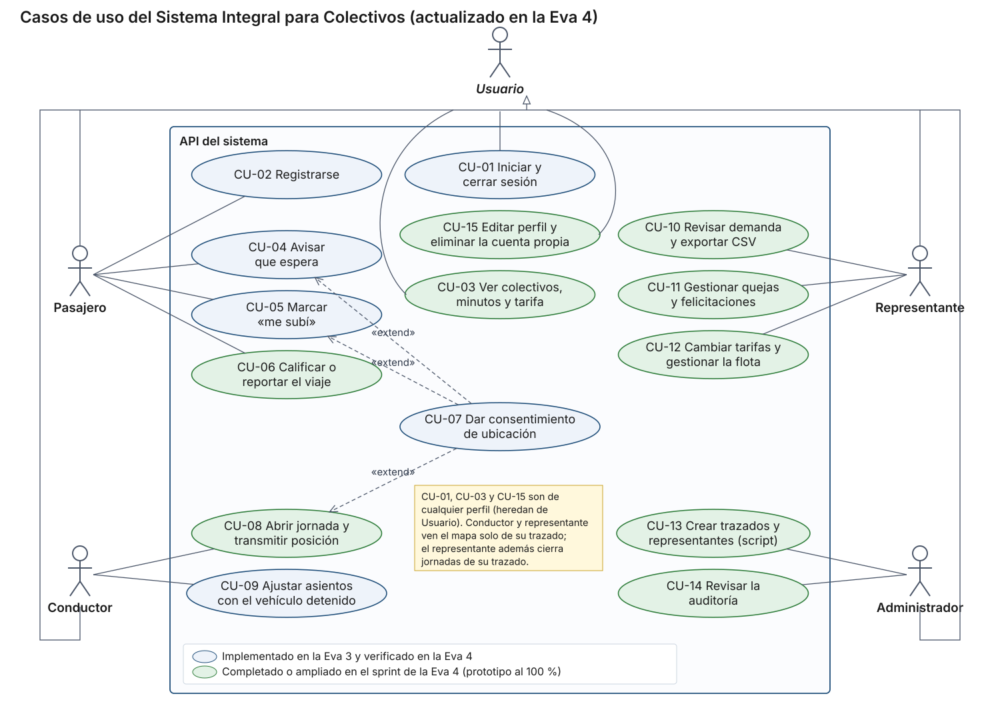

## Componentes

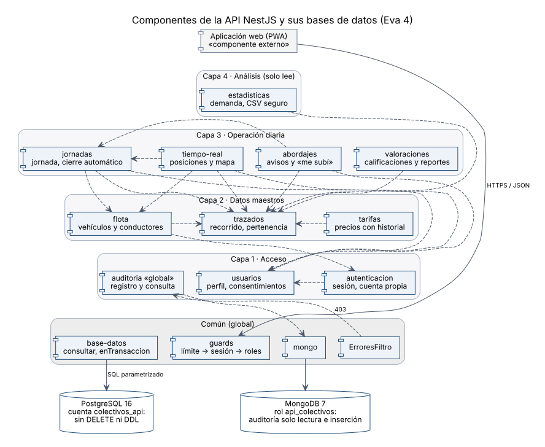

## Clases: cuentas, acceso y auditoría

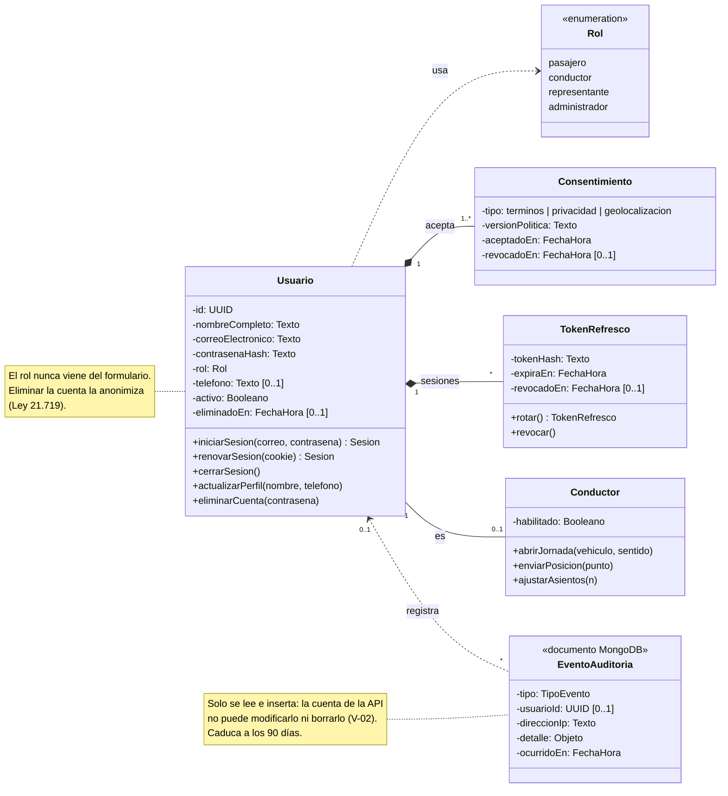

## Clases: trazado, tarifas y flota

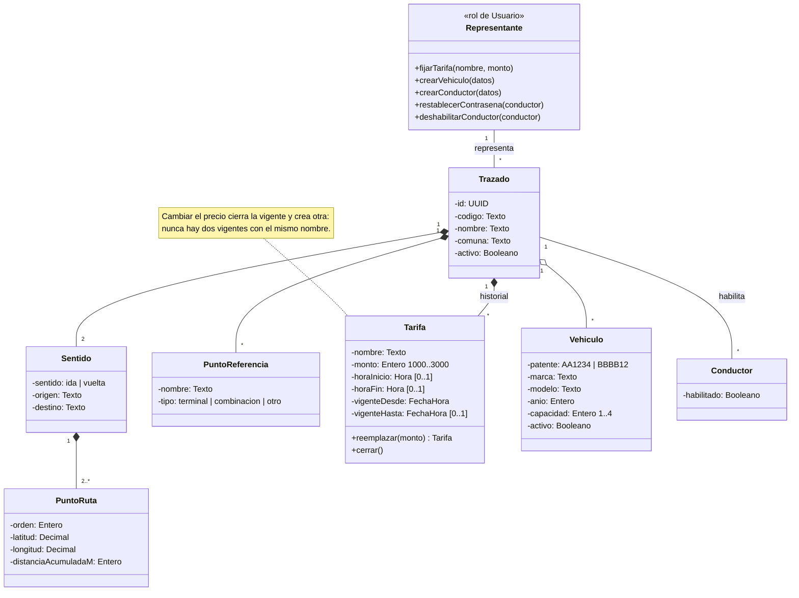

## Clases: operación diaria

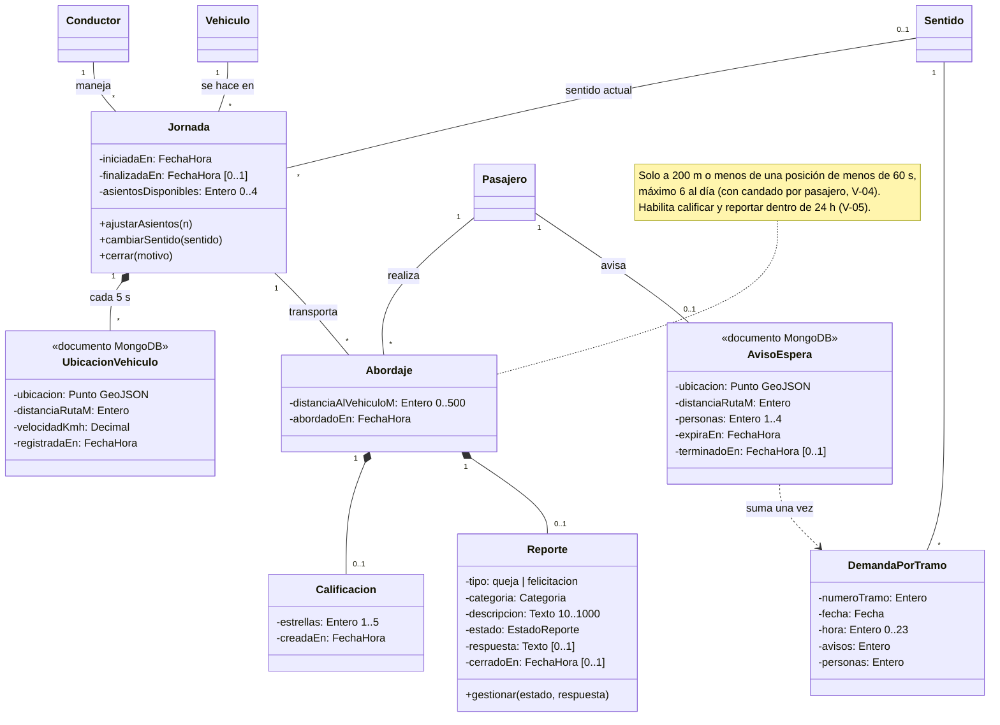

## Clases: diseño del control de acceso

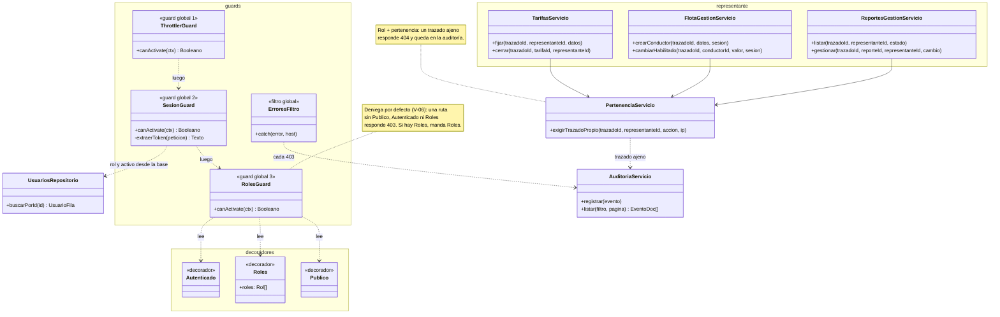

## Estados de la jornada

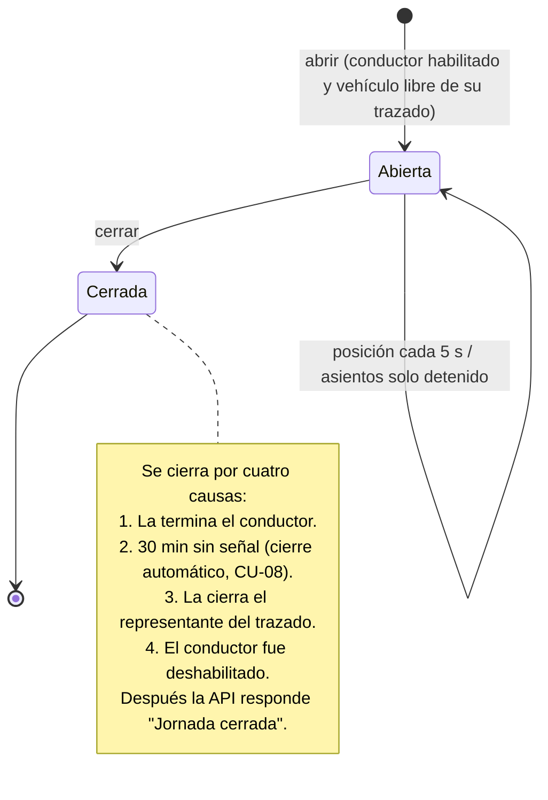

## Estados del reporte

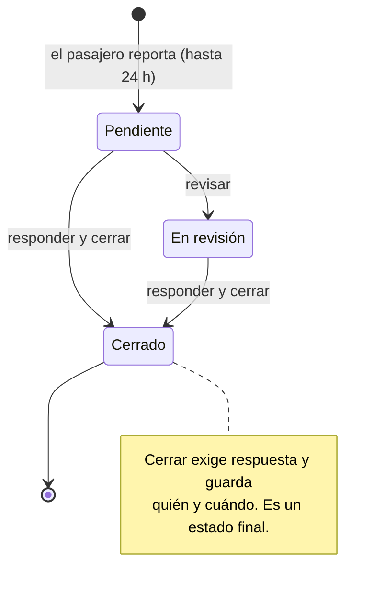

## Estados del aviso de espera

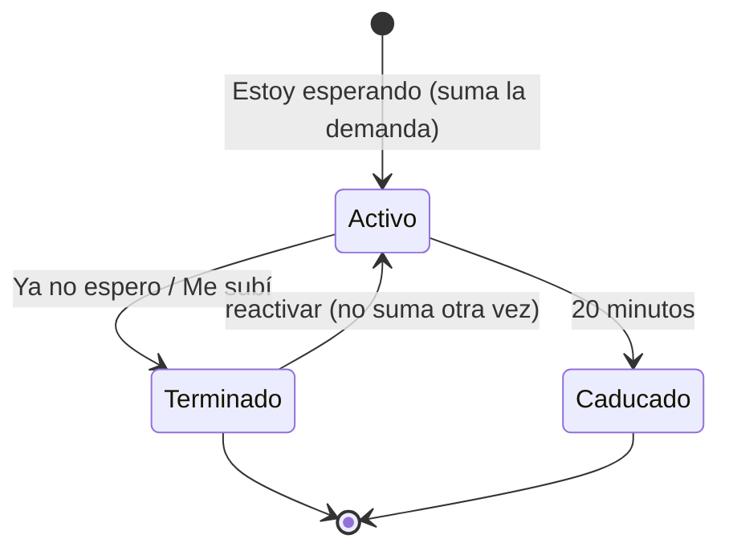

## Estados del colectivo en el mapa

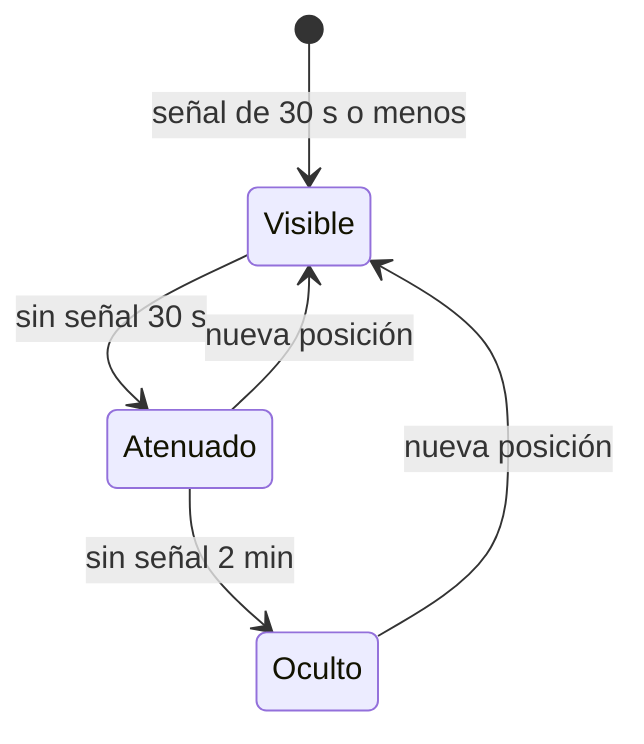

## Secuencia: «me subí» (CU-05)

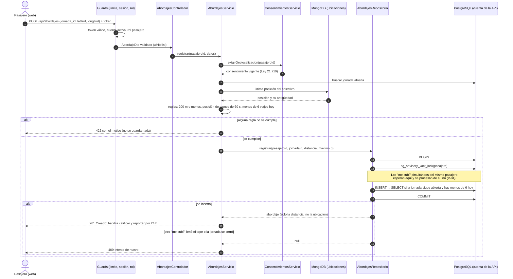

## Secuencia: gestión de un reporte (CU-11)

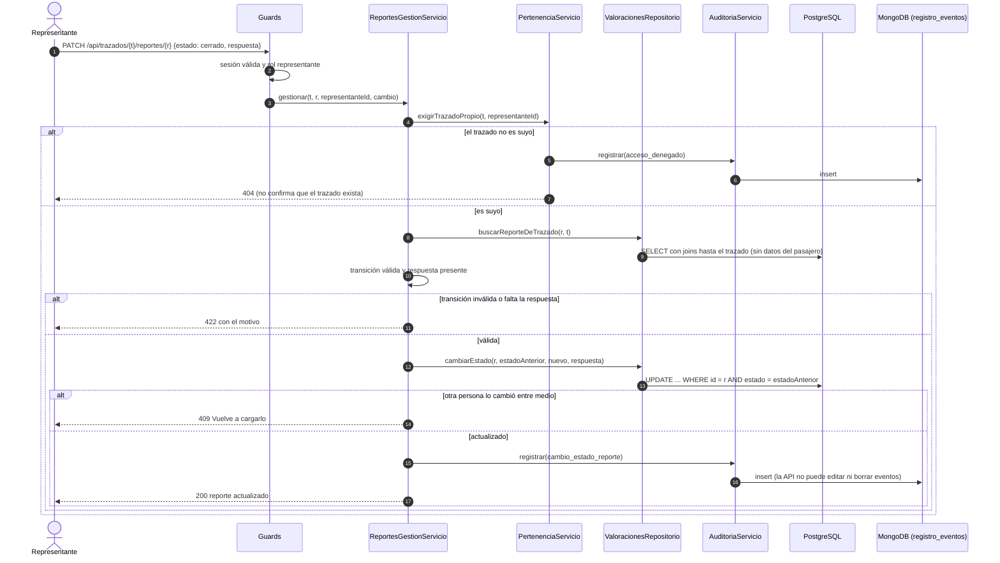

## Secuencia: control de acceso en cada petición

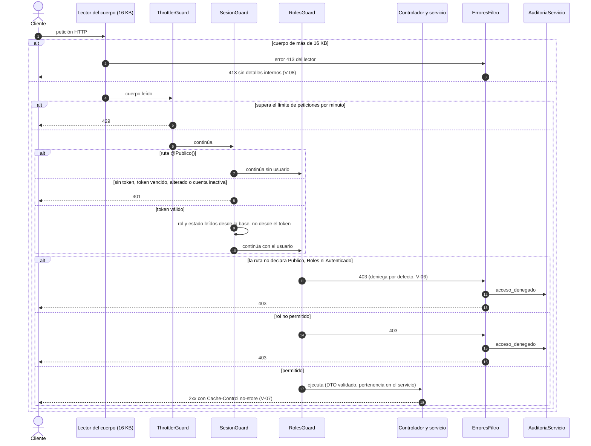
